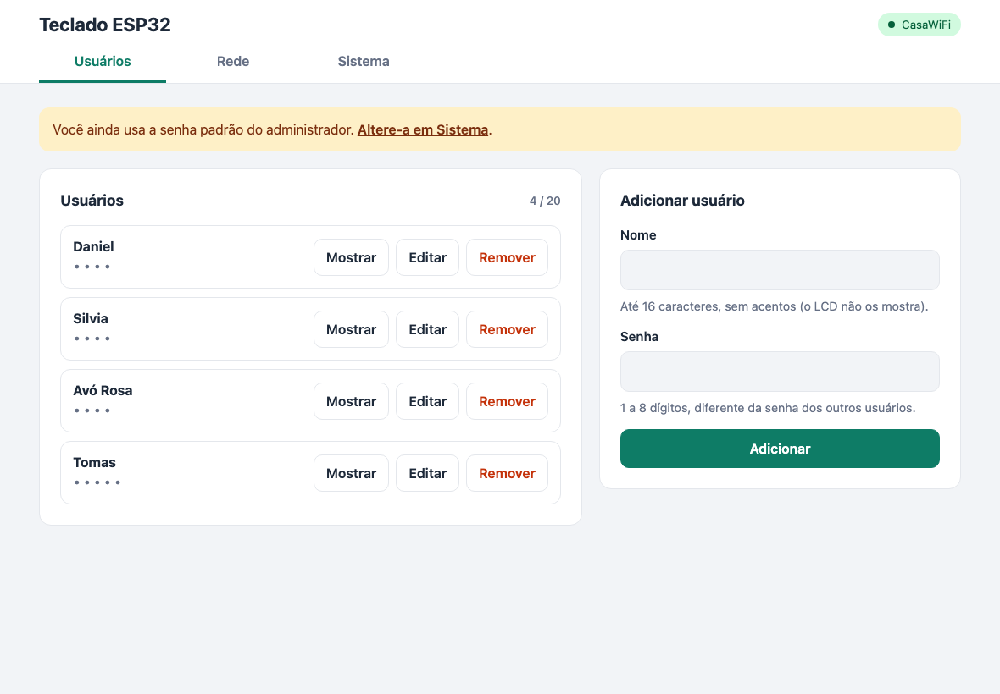
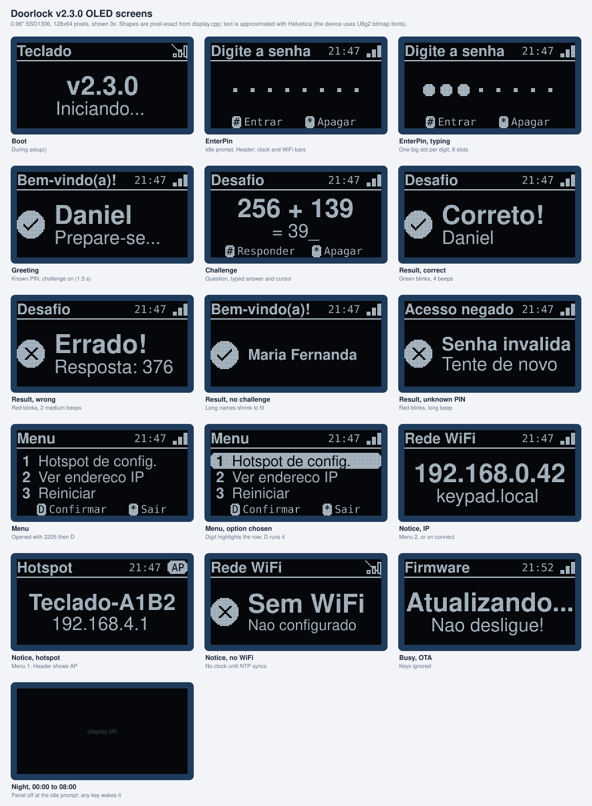
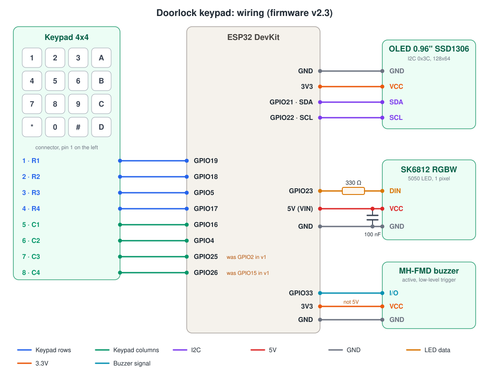

# Doorlock: ESP32 PIN keypad with a math challenge

An ESP32 project for fun. People type a PIN on a 4x4 keypad. If the PIN belongs to someone, the OLED screen greets them by name and, if that person has the math challenge turned on, asks a quick math question (for example `256 + 139`). An RGBW LED and an active buzzer give color and sound feedback. You manage people and PINs from a web page that works on phones, tablets and computers.

> This is a game, not a security device. PINs are stored in plain text, and the web page has no login: anyone on your network can open it. Do not use it to control a real lock.



## Features

- **Keypad game:** PIN entry with masked digits, a greeting, then a random addition, subtraction or multiplication challenge.
- **Math challenge per user:** each user has an option to do the challenge or not. Without it, the keypad only greets the user by name.
- **LED feedback:** yellow flash on every key, 3 green blinks for a correct PIN or answer, 3 red blinks for a wrong one.
- **Sound feedback:** an MH-FMD active buzzer clicks on every key, beeps twice quickly for a correct PIN or answer, and gives one long beep for a wrong one. It is switched with `digitalWrite()`, so it needs no extra library.
- **Web page (Portuguese UI), no login:** add, edit and remove users, and choose who does the math challenge; choose a WiFi network; install firmware updates; restart. The layout adapts to phones, tablets (two columns from 768 px) and desktops, with large touch targets and dark mode.
- **Keypad menu:** type `2205` then `D` to open a menu on the display: open the setup hotspot, show the IP address, or restart.
- **WiFi setup hotspot:** an open `Teclado-XXXX` network with a captive portal. It starts only from the keypad menu, never by itself.
- **Auto-reconnect:** if the WiFi is down or drops, the device keeps retrying the saved network forever.
- **Web (OTA) firmware updates:** upload a `firmware.bin` from the browser, with a progress bar.
- **Persistent storage:** users and WiFi credentials survive reboots and power loss. Users saved by firmware v1 are kept.
- **Non-blocking firmware:** the keypad, display, LED, WiFi and web server all run together without `delay()` in the main loop.
- **OLED screen:** a 0.96" 128x64 display shows a header (title, clock, network icon), large text with check or X icons, a dot per typed PIN digit, and key hints at the bottom.
- **Night screen-off:** from 00:00 to 08:00 the screen turns off when nobody uses the keypad for 30 s, which slows OLED burn-in. Any key wakes it. The clock comes from the internet (NTP), so this needs WiFi.



Every screen is described in [docs/DESIGN.md](docs/DESIGN.md#oled-screens).

## Wiring at a glance



| Part | Part pin | ESP32 |
|---|---|---|
| Keypad | 1, 2, 3, 4 (rows R1 to R4) | GPIO 19, 18, 5, 17 |
| Keypad | 5, 6, 7, 8 (columns C1 to C4) | GPIO 16, 4, **25**, **26** |
| OLED I2C | SDA / SCL | GPIO 21 / GPIO 22 |
| OLED I2C | VCC / GND | **3V3** / GND |
| SK6812 LED | DIN (through 330 Ω) | GPIO 23 |
| SK6812 LED | VCC / GND | 5V (VIN) / GND, with 100 nF across them |
| MH-FMD buzzer | I/O | GPIO 33 |
| MH-FMD buzzer | VCC / GND | **3V3** / GND (not 5V, see [docs/hardware.md](docs/hardware.md#electrical-notes)) |

The full parts list, the board pinout and the electrical notes are in [docs/hardware.md](docs/hardware.md).

## Quick start

1. **Wire the parts** as shown above.
2. **Build and flash over USB** (the first flash must be over USB):
   - PlatformIO: `pio run -t upload`, then `pio device monitor` to see the logs.
   - Arduino IDE: see [docs/firmware.md](docs/firmware.md#arduino-ide).
3. **Open the setup hotspot.** On the keypad, type `2205`, press `D`, then press `1` and `D`. The display shows the hotspot name (`Teclado-XXXX`) and `192.168.4.1`.
4. **Join the hotspot** from a phone or tablet. It has no password. The setup page should open by itself. If it does not, browse to `http://192.168.4.1/`.
5. **Choose your network** in the **Rede** tab: tap **Procurar redes**, pick your network, type its password and tap **Salvar e conectar**. Once the device connects, the hotspot closes after about a minute.
6. **Open the web page on your network** at `http://keypad.local/`, or at the IP the display shows. To see the IP again, use menu option 2.

## Using the keypad

| Key | Action |
|---|---|
| `0` to `9` | Type a digit (PIN digits show as dots) |
| `#` | Confirm |
| `*` | Clear what you typed |
| `D` | After `2205`: open the menu |
| `A`, `B`, `C` | Not used |

### Menu

Type `2205` and press `D`. The display shows a numbered list:

```
1 Hotspot de config.
2 Ver endereco IP
3 Reiniciar
```

Press the option's digit (its row is highlighted), then `D` to confirm. `*` leaves the menu. The menu also closes after 30 s without a key press.

| Option | Action |
|---|---|
| `1` + `D` | Open the setup hotspot and show its name and IP for 20 s |
| `2` + `D` | Show the IP address for 10 s (or "Sem WiFi") |
| `3` + `D` | Restart the device |
| `*` | Leave the menu |

After an option runs, any key (or the timeout) goes back to the PIN prompt. The menu code is `MENU_CODE` in `src/config.h`. A user whose PIN is `2205` can still log in with `#`.

Default users on a fresh device: `Daniel` with PIN `1234` and `Silvia` with PIN `5678`.

## Documentation

New here? Start with [docs/FUNDAMENTALS.md](docs/FUNDAMENTALS.md). AI assistants should read [docs/AI.md](docs/AI.md) first.

| Topic | Document |
|---|---|
| Big picture, concepts, documentation map | [docs/FUNDAMENTALS.md](docs/FUNDAMENTALS.md) |
| Modules, main loop, data flow, storage | [docs/ARCHITECTURE.md](docs/ARCHITECTURE.md) |
| OLED screens, light and sound, web page design | [docs/DESIGN.md](docs/DESIGN.md) |
| File-by-file guide | [docs/CODEBASE.md](docs/CODEBASE.md) |
| Build, configure, extend | [docs/DEVELOPMENT.md](docs/DEVELOPMENT.md) |
| HTTP API reference | [docs/API.md](docs/API.md) |
| Flashing, OTA, upgrades | [docs/DEPLOYMENT.md](docs/DEPLOYMENT.md) |
| Problems and fixes | [docs/TROUBLESHOOTING.md](docs/TROUBLESHOOTING.md) |
| Checks and manual test checklist | [docs/TESTING.md](docs/TESTING.md) |
| Code and docs conventions | [docs/STYLEGUIDE.md](docs/STYLEGUIDE.md) |
| Why things are the way they are | [docs/DECISIONS.md](docs/DECISIONS.md) |
| Rules and context for AI assistants | [docs/AI.md](docs/AI.md) |

Reference pages:

- [docs/hardware.md](docs/hardware.md): parts list, wiring, board pinout, electrical notes and troubleshooting.
- [docs/firmware.md](docs/firmware.md): building, configuration, architecture, state machine, storage and the developer guide.
- [docs/web-ui.md](docs/web-ui.md): the web page, the setup hotspot, firmware updates and the HTTP API.

## Project layout

```
platformio.ini            Build configuration (board, libraries, partition table)
src/
  main.cpp                Wiring of the modules, setup() and loop()
  config.h                Pins, timings, limits and defaults
  game.h/.cpp             Keypad state machine (PIN, greeting, challenge, result)
  display.h/.cpp          0.96" OLED drawing (U8g2)
  led.h/.cpp              Non-blocking SK6812 LED effects
  buzzer.h/.cpp           Non-blocking active buzzer beep patterns
  users.h/.cpp            User list stored in flash (NVS)
  settings.h/.cpp         WiFi credentials stored in flash
  wifi_service.h/.cpp     Station mode, endless reconnect, setup hotspot, mDNS
  web_ui.h/.cpp           Web server, JSON API and OTA upload
  web_page.h              The web page (HTML, CSS, JavaScript)
  util.h                  Overflow-safe timing helper
docs/                     Documentation and diagrams
```

## Upgrading from firmware v2.1

1. **Replace the LCD with a 0.96" SSD1306 OLED** (128x64, I2C). Wire SDA to GPIO 21, SCL to GPIO 22, VCC to **3V3** (not 5V) and GND to GND. Pin order varies between modules, so follow the labels. A 1.3" module uses an SH1106 controller: change the driver class in `src/display.h` (see [docs/hardware.md](docs/hardware.md#troubleshooting)).
2. **Update from the browser** or over USB. The partition table did not change. Users and WiFi settings are kept.
3. **Check the clock.** The header clock and the night screen-off use `TIME_ZONE` in `src/config.h` (Brasilia time by default). They need WiFi; without it the clock is hidden and the screen stays on.

## Upgrading from firmware v2.0

1. **Wire the buzzer** (optional): I/O to GPIO 33, VCC to 3V3, GND to GND. Without it the firmware works as before, just silently.
2. **Update from the browser.** The partition table did not change, so the Sistema tab or `curl` works (see [docs/web-ui.md](docs/web-ui.md#firmware-updates-ota)).
3. **Existing users keep the math challenge.** Turn it off per user in the **Usuários** tab.

## Upgrading from firmware v1

1. **Move two keypad wires.** Keypad pin 7 goes from GPIO 2 to **GPIO 25**, and pin 8 goes from GPIO 15 to **GPIO 26**. GPIO 2 and 15 are boot strapping pins and could stop the board from booting or flashing.
2. **Flash over USB once.** v2 uses a partition table with larger app slots (1.9 MB each) so that the firmware, which now includes web updates, fits with room to grow. After that, updates can happen from the browser.
3. **Your users are kept.** v2 reads the same flash namespace and format as v1.
4. **Set up WiFi from the hotspot** (menu option 1). The WiFi name and password are no longer in the code. You can still set `DEFAULT_WIFI_SSID` and `DEFAULT_WIFI_PASS` in `src/config.h` if you prefer.
5. **The web page has no login any more.** The admin user and password from v1 are gone.

## License

GPL-3.0. See [LICENSE](LICENSE).
