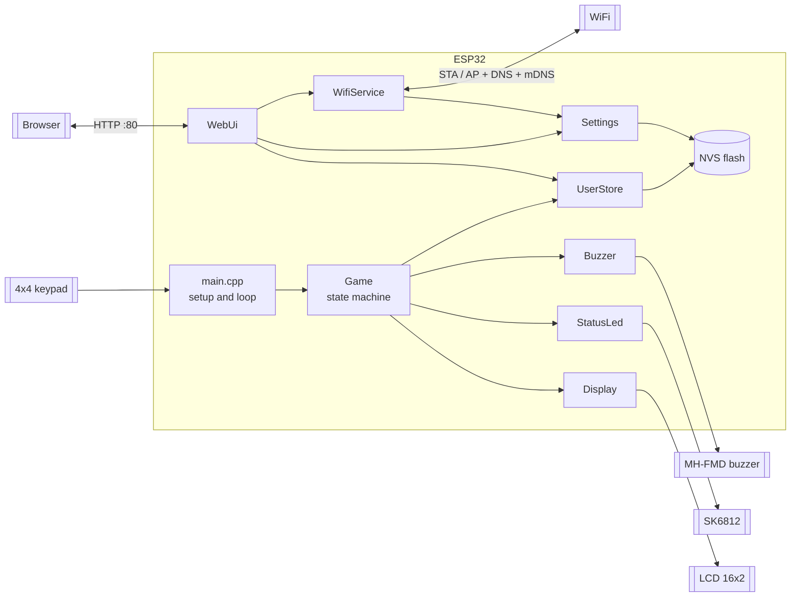
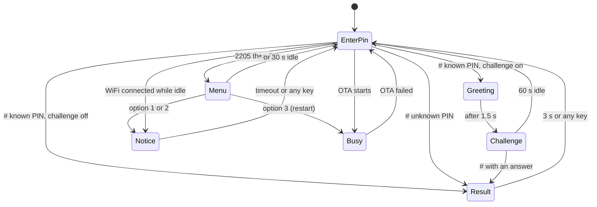

# Architecture

## System view



Each module owns one piece of hardware or one concern. Only `main.cpp` knows about all of them; it creates the objects as globals, wires callbacks and runs the loop.

## Modules and dependencies

| Module | Owns | Depends on |
|---|---|---|
| `main.cpp` | Object creation, keypad reading, menu actions, WiFi event reactions, OTA callbacks | everything |
| `Game` | Keypad state machine, menu, all LCD text | `Display`, `StatusLed`, `Buzzer`, `UserStore` |
| `Display` | LCD; rewrites only changed lines | `LiquidCrystal_I2C` |
| `StatusLed` | One SK6812 pixel: key flash and N blinks | `Adafruit_NeoPixel` |
| `Buzzer` | Active buzzer on/off patterns | Arduino `digitalWrite` |
| `UserStore` | Users and their challenge option in NVS | `Preferences` |
| `Settings` | WiFi credentials in NVS | `Preferences` |
| `WifiService` | Station mode, endless retries, setup hotspot, captive DNS, mDNS, events | `WiFi`, `DNSServer`, `ESPmDNS`, `Settings` |
| `WebUi` | HTTP routes, JSON, OTA upload, delayed reboot | `WebServer`, `Update`, `UserStore`, `Settings`, `WifiService` |
| `web_page.h` | The single-page UI as a PROGMEM string | none |
| `util.h` | `timeReached()` overflow-safe deadline check | none |

Rules that keep this shape:

- `Game` never touches WiFi or the web server. It reports menu choices through the `onMenuAction` callback and `main.cpp` acts on them.
- `WebUi` never touches the LCD. It reports OTA progress through `onOtaStart` / `onOtaEnd` and `main.cpp` updates the LCD, LED and buzzer.
- `WifiService` reports connection changes as events (`takeEvent()`), polled by `main.cpp`.

## The main loop

```text
setup():  Serial, Wire, display, led, buzzer, random seed,
          settings, users, wifi (starts TCP/IP), web callbacks, web, game

loop():   wifi.update()      reconnects, hotspot DNS, events
          web.update()       one HTTP client, delayed reboot
          led.update()       advances blink phases
          buzzer.update()    advances beep steps
          game.update()      screen timeouts
          handleWifiEvents() shows the IP when connected and idle
          restart check      menu option 3
          keypad.getKey()    on a key: led.keyFlash(), buzzer.play(Key), game.handleKey()
```

Every `update()` is cheap and returns at once when nothing is due. Time is compared with `timeReached(deadline)` from `util.h`, which survives the `millis()` wrap after about 49 days. The only blocking moment is an OTA upload: `WebServer` handles the whole request inside `web.update()`, so the keypad freezes for a few seconds and `Buzzer::stop()` is called first so no beep gets stuck on.

## Keypad state machine



States are `Game::State`: `EnterPin`, `Greeting`, `Challenge`, `Result`, `Notice`, `Busy`, `Menu`. Screen texts per state are in [DESIGN.md](DESIGN.md#lcd-screens).

## Data flows

**Key press.** `keypad.getKey()` returns a char. `main.cpp` flashes the LED yellow and plays the key click, then `Game::handleKey()` acts by state. On `#` in `EnterPin`, `Game::submitPin()` asks `UserStore::findByPin()`. On success it copies the name, reads `UserStore::challenge(index)` and chooses `Greeting` or `Result`. Result feedback (`StatusLed::blink`, `Buzzer::play(Success/Error)`) replaces the key click.

**Web request.** The browser loads `/` (the embedded page), then calls `/api/*` with `fetch`. `WebUi` validates input through `UserStore` or `Settings`, which save to NVS and return a result code. `WebUi` turns it into JSON. See [API.md](API.md).

**OTA.** `/api/update` receives a multipart upload in chunks (`handleOtaUpload`), writes it with `Update` into the inactive app slot, then `handleOtaDone` answers and schedules a reboot 1.5 s later.

**WiFi.** `WifiService::update()` retries the stored network every 15 s (30 s while the hotspot is up). On connect it starts mDNS (`keypad.local`) and pushes `Event::Connected`. A hotspot started from the menu stays up until a network saved while it was up connects, plus 60 s.

## Storage

| NVS namespace | Key | Content |
|---|---|---|
| `keypad` | `count` | `uint8` number of users |
| `keypad` | `users` | 520-byte blob, `User[20]` of `{char name[17]; char pin[9];}` (v1 layout) |
| `keypad` | `challenge` | 20-byte blob, one byte per user, 1 = challenge on (added in v2.1) |
| `settings` | `wifi_ssid`, `wifi_pass` | WiFi credentials |

Writes happen only on add, edit or remove. Blobs are written before `count`. More in [firmware.md](firmware.md#storage).

## Memory and flash

- Partition table `min_spiffs.csv`: two 1.9 MB app slots (OTA) and a small SPIFFS that the firmware does not use.
- The web page is a PROGMEM string served with `send_P`, so it does not use heap.
- JSON is built with Arduino `String` and `reserve()`; responses are small (at most 20 users).
