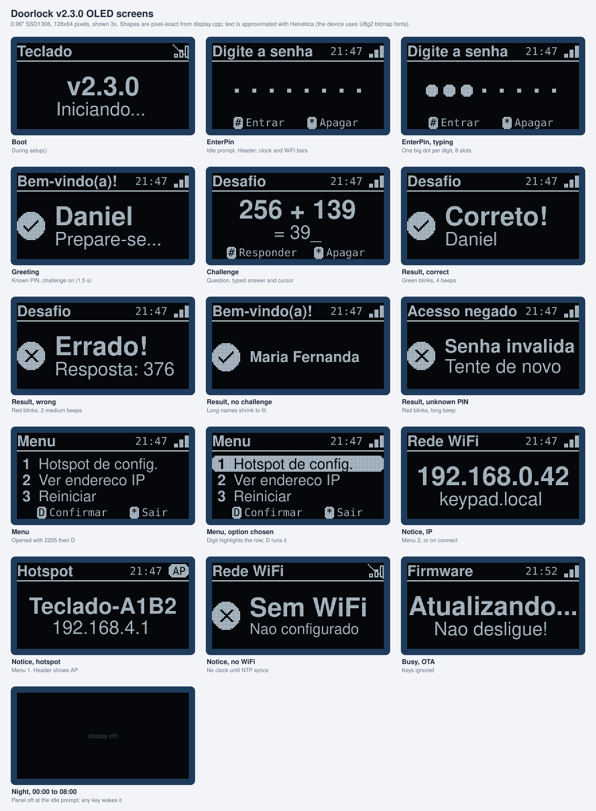

# Design

How the device looks, sounds and reads to the people who use it. Text shown to people is in Portuguese; everything else (code, docs) is in English.

## Principles

- **Immediate feedback.** Every key press lights the LED and clicks the buzzer. Every outcome has a screen, a color and a sound.
- **Never stuck.** Every screen has a timeout back to the PIN prompt, and most also accept any key to go back.
- **Result feedback wins.** A key press never cuts a green or red blink or a success or error beep pattern short.
- **Fits the hardware.** Screen text is ASCII without accents, because the display fonts have none. Long text shrinks to a smaller font.
- **Spares the OLED.** The panel turns off at night while nobody uses the keypad, to slow burn-in.
- **Toy-grade security is visible.** The web page does not pretend to be secure (no fake login).

## Keypad

| Key | Action |
|---|---|
| `0` to `9` | Type a digit (PIN shows dots, answers show digits) |
| `#` | Confirm |
| `*` | Clear the input, or leave the menu |
| `D` | After `2205`: open the menu. In the menu: confirm the chosen option |
| `A`, `B`, `C` | Not used (reserved) |

Limits: PIN up to 8 digits (`USER_PIN_LEN`), answer up to 6 digits (`ANSWER_MAX_LEN`). Extra digits are ignored.

## OLED screens

The display is a 0.96" SSD1306 OLED with 128x64 pixels. The preview below shows every screen at 3x scale. It is approximate: the shapes are pixel-exact from `src/display.cpp`, but the text uses Helvetica instead of the U8g2 bitmap fonts of the device.

Every screen has the same frame:

- **Header** (rows 0 to 15, so it fits the yellow band of two-color modules): the title on the left; on the right the clock `HH:MM` (only after NTP has synced) and a network icon. Filled signal bars mean connected, outlined bars with a slash mean offline, and an inverted `AP` badge means the setup hotspot is on. A line separates the header from the body.
- **Body**, one of three layouts:
  - **Message:** the main text in the largest bold font that fits (`helvB14`, then 12, 10, 08), an optional detail line below it (`helvR10` or `helvR08`), and an optional round icon on the left (check for success, X for errors).
  - **Pin:** 8 slots, a large dot per typed digit and small dots for the rest. Digits never show, and the slots do not reveal the PIN length beyond the maximum of 8.
  - **Menu:** numbered rows; the chosen row is highlighted (inverted).
- **Footer** (optional): key hints drawn as small inverted keycaps, for example `[#] Entrar  [*] Apagar`.

The frame is sent to the panel only when something changed. Text is ASCII only, because the fonts have no accents. There is no fixed character limit: long text shrinks to a smaller font and is clipped only if it still does not fit (about 100 px wide next to an icon, 128 px otherwise).

| State | Title | Main text | Detail | Icon | Footer | Leaves after |
|---|---|---|---|---|---|---|
| Boot | `Teclado` | `v2.2.0` | `Iniciando...` | | | setup ends |
| `EnterPin` | `Digite a senha` | Pin layout, one dot per digit | | | `# Entrar`, `* Apagar` | half-typed input clears after 20 s |
| `Greeting` | `Bem-vindo(a)!` | name | `Prepare-se...` | check | | 1.5 s, then the challenge |
| `Challenge` | `Desafio` | `256 + 139` | `= ` + typed answer + `_` | | `# Responder`, `* Apagar` | `#`, or 60 s idle |
| `Result`, correct | `Desafio` | `Correto!` | name | check | | 3 s or any key |
| `Result`, wrong | `Desafio` | `Errado!` | `Resposta: <answer>` | X | | 3 s or any key |
| `Result`, unknown PIN | `Acesso negado` | `Senha invalida` | `Tente de novo` | X | | 3 s or any key |
| `Result`, no challenge | `Bem-vindo(a)!` | name | | check | | 3 s or any key |
| `Menu` | `Menu` | rows `1 Hotspot de config.`, `2 Ver endereco IP`, `3 Reiniciar`; typing `1` to `3` highlights a row | | | `D Confirmar`, `* Sair` | `*`, `D`, or 30 s idle |
| `Notice`, IP | `Rede WiFi` | the IP | `keypad.local` | | | 10 s (menu) or 4 s (on connect) |
| `Notice`, no WiFi | `Rede WiFi` | `Sem WiFi` | `Nao configurado` / `Conectando...` | X / none | | 4 s or 10 s |
| `Notice`, hotspot | `Hotspot` | `Teclado-XXXX` | `192.168.4.1` | | | 20 s |
| `Busy`, OTA | `Firmware` | `Atualizando...`, then `Atualizado!` | `Nao desligue!`, then `Reiniciando...` | none, then check | | OTA end |
| `Busy`, restart | `Sistema` | `Reiniciando...` | | | | restart |

### Night screen-off

OLED pixels wear out when they show the same image for a long time (burn-in), and the PIN prompt is static. From `DISPLAY_OFF_HOUR` (00:00) to `DISPLAY_ON_HOUR` (08:00) local time, the panel turns off when the PIN prompt is empty and no key was pressed for 30 s (`DISPLAY_NIGHT_WAKE_MS`). Any key turns it on again, and that key is also processed normally, so a digit is typed. A notice, such as the IP after WiFi connects, also turns it on. The time comes from NTP, so until the clock is synced (for example without WiFi) the screen never turns off. Equal hours disable the feature.

Challenge operands: addition `a, b` in [100, 500); subtraction `a` in [200, 900), `b` in [100, a); multiplication `a` in [12, 100), `b` in [2, 10). The `x` sign is used for multiplication.

## Light and sound

| Event | LED | Buzzer (active, fixed pitch) |
|---|---|---|
| Any key | Yellow 250 ms | Click 30 ms |
| Correct PIN or answer, OTA success | 3 green blinks | Two quick beeps (70 on, 70 off, 70 on) |
| Wrong PIN or answer, OTA failure | 3 red blinks | One long beep, 600 ms |
| Menu opened | 1 green blink | Key click only |

The buzzer is active, so it cannot change pitch: sounds differ by rhythm only. Yellow is `(255, 160, 0)` because full green makes the SK6812 look green.

## Web page

One HTML page, three tabs: **Usuários**, **Rede**, **Sistema**. Details of each tab are in [web-ui.md](web-ui.md).

Layout:

- Phones: one column, full-width buttons.
- 768 px and wider: two columns (`.grid.two`, list on the left, form on the right).
- 1024 px and wider: the user list itself uses two columns.
- Touch targets of 44 to 48 px, `font-size: 16px` on inputs (no iOS zoom), safe-area insets for notched screens.

Design tokens (CSS custom properties in `src/web_page.h`):

| Token | Light | Dark | Use |
|---|---|---|---|
| `--bg` | `#f2f4f7` | `#0f1418` | Page and input background |
| `--card` | `#fff` | `#182026` | Cards, header |
| `--text` | `#1d2939` | `#e7ecf0` | Body text |
| `--muted` | `#667085` | `#98a2b3` | Hints, secondary text |
| `--line` | `#e4e7ec` | `#2a343c` | Borders, neutral tags |
| `--accent` | `#0e7c66` | `#33c3a0` | Primary buttons, active tab, focus, checkboxes |
| `--danger` | `#c4320a` | `#f97066` | Destructive buttons, error toasts |
| `--ok` / `--on-ok` | `#d1fadf` / `#05603a` | `#0c3b2a` / `#75e0a7` | Connected pill, "Com desafio" tag |

Components: `.card`, `.pill` (network status), `.tag` / `.tag.on` (challenge status), `.hint`, `.row`, `.block`, `button.primary`, `button.danger`, `label.check` (checkbox row), `#toast` (status messages, red when `.bad`).

Interaction rules:

- Destructive or disruptive actions (remove user, change WiFi, OTA, reboot) ask `confirm()` first.
- Every API result shows a toast. Errors show the server's Portuguese message.
- PINs are masked as dots in the list, with a **Mostrar** toggle.
- The status refreshes every 10 s.
