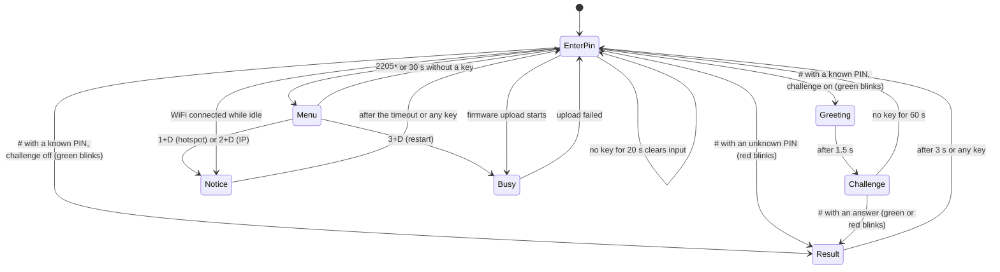

# Firmware

## Building

### PlatformIO (recommended)

The repository is a PlatformIO project. `platformio.ini` selects the board, the libraries and the partition table.

```sh
pio run                 # build
pio run -t upload       # build and flash over USB
pio device monitor      # serial logs at 115200 baud
```

The built firmware is `.pio/build/esp32dev/firmware.bin`. Upload it from the web page (Sistema tab) for later updates.

### Arduino IDE

1. Install the **esp32 by Espressif Systems** board package (core 2.x or 3.x).
2. Install these libraries with the Library Manager:

   | Library | Author |
   |---|---|
   | Keypad | Mark Stanley, Alexander Brevig |
   | U8g2 | oliver |
   | Adafruit NeoPixel | Adafruit |

   `WiFi`, `WebServer`, `ESPmDNS`, `DNSServer`, `Preferences`, `Update` and `Wire` come with the ESP32 core. The clock uses `configTzTime()` from the core, so it needs no library.
3. Create a folder named `doorlock`, copy every file from `src/` into it, and rename `main.cpp` to `doorlock.ino`. The `.ino` file must have the same name as its folder.
4. Select **Tools > Board > ESP32 Dev Module** and **Tools > Partition Scheme > Minimal SPIFFS (1.9MB APP with OTA)**.
5. Upload. For a later web update, use **Sketch > Export Compiled Binary** and upload the `.bin` file from the web page.

### Partition table

Web updates need two app slots: the new firmware is written to the inactive slot, then the device boots from it. The default table has two 1.25 MB slots, which leaves little room once WiFi, the web server and the update code are linked in. `min_spiffs.csv` provides two 1.9 MB slots instead. The NVS area that holds users and settings sits at the same address in every standard table, so it is not erased when you switch tables.

## Configuration

Everything you would normally change is in `src/config.h`.

| Constant | Default | Meaning |
|---|---|---|
| `PIN_KEYPAD_ROW_1..4` | 19, 18, 5, 17 | Keypad rows (connector pins 1 to 4) |
| `PIN_KEYPAD_COL_1..4` | 16, 4, 25, 26 | Keypad columns (connector pins 5 to 8) |
| `PIN_I2C_SDA`, `PIN_I2C_SCL` | 21, 22 | OLED I2C bus |
| `PIN_LED` | 23 | SK6812 data |
| `DISPLAY_I2C_ADDRESS` | `0x3C` | OLED address (some modules use `0x3D`) |
| `DISPLAY_I2C_CLOCK_HZ` | 400000 | I2C clock for the OLED |
| `DISPLAY_CONTRAST` | 160 | 0 to 255; lower slows burn-in |
| `DISPLAY_ROTATE_180` | `false` | `true` if the module is mounted upside down |
| `DISPLAY_OFF_HOUR`, `DISPLAY_ON_HOUR` | 0, 8 | Night screen-off window in local time (00:00 to 08:00). Equal hours disable it |
| `DISPLAY_NIGHT_WAKE_MS` | 30000 | At night, the screen turns off this long after the last key |
| `TIME_ZONE` | `"<-03>3"` | POSIX TZ string for the clock (Brasilia, UTC-3, no DST) |
| `NTP_SERVER_1`, `NTP_SERVER_2` | `"pool.ntp.org"`, `"time.google.com"` | Time servers |
| `LED_BRIGHTNESS` | 80 | 0 to 255 |
| `LED_KEY_FLASH_MS`, `LED_BLINK_MS`, `LED_BLINK_COUNT` | 250, 250, 3 | LED timings |
| `PIN_BUZZER` | 33 | MH-FMD buzzer I/O |
| `BUZZER_ACTIVE_LOW` | `true` | The module turns on with LOW (MH-FMD). `false` for a circuit that turns on with HIGH |
| `BUZZER_KEY_MS` | 30 | Key click length |
| `GREETING_MS`, `RESULT_MS`, `NOTICE_MS` | 1500, 3000, 4000 | How long each screen stays |
| `MENU_CODE` | `"2205"` | Code typed before `D` to open the menu |
| `MENU_TIMEOUT_MS` | 30000 | The menu closes after this much inactivity |
| `MENU_INFO_MS`, `HOTSPOT_INFO_MS` | 10000, 20000 | How long the IP and hotspot screens stay |
| `PIN_ENTRY_TIMEOUT_MS` | 20000 | A half-typed PIN is cleared after this much inactivity |
| `CHALLENGE_TIMEOUT_MS` | 60000 | An unanswered challenge returns to the prompt |
| `ANSWER_MAX_LEN` | 6 | Digits allowed in a challenge answer |
| `MAX_USERS`, `USER_NAME_LEN`, `USER_PIN_LEN` | 20, 16, 8 | User list limits (see [Storage](#storage)) |
| `WIFI_HOSTNAME` | `keypad` | mDNS name: `http://keypad.local/` |
| `DEFAULT_WIFI_SSID`, `DEFAULT_WIFI_PASS` | empty | Optional first-boot WiFi credentials |
| `SETUP_AP_PREFIX` | `Teclado` | Setup hotspot name prefix (the hotspot is open) |
| `WIFI_RETRY_MS`, `WIFI_RETRY_WITH_AP_MS` | 15000, 30000 | Reconnect interval without and with the hotspot running |
| `WIFI_AP_LINGER_MS` | 60000 | The hotspot stays open this long after a network saved from it connects |

The `DEFAULT_*` values only apply while nothing is stored in flash. After you save a WiFi network from the web page, the stored values win.

## Architecture

Each module owns one piece of hardware or one concern. `main.cpp` creates them, connects them and runs the loop.

| Module | Responsibility |
|---|---|
| `main.cpp` | Creates all objects, reads the keypad, runs menu actions, reacts to WiFi events, hooks OTA progress to the display, updates the header clock and network icon, turns the screen off at night |
| `game` | Keypad state machine, the menu, and the content of every screen |
| `display` | 128x64 OLED drawn with U8g2: header, body layouts, footer and power save. Sends a frame only when something changed |
| `led` | Non-blocking LED effects: key flash and N blinks |
| `buzzer` | Non-blocking on/off beep patterns for the active buzzer |
| `users` | User list and per-user math challenge option in NVS, validation, add, edit and remove |
| `settings` | WiFi credentials in NVS |
| `wifi_service` | Station connection, endless retries, on-demand setup hotspot, captive-portal DNS, mDNS |
| `web_ui` | HTTP routes, JSON API, OTA upload, delayed reboot |
| `web_page.h` | The single-page web UI, stored in flash |

Every `loop()` pass runs, in order: `wifi.update()`, `web.update()`, `led.update()`, `buzzer.update()`, `game.update()`, the WiFi event handler, `updateDisplayStatus()` (once a second: network icon, clock, night screen-off), then one keypad read. Nothing in the loop blocks. Timers compare `millis()` with `timeReached()` from `util.h`, which stays correct when `millis()` wraps around after about 49 days.

The one exception is a firmware upload: the web server processes the whole upload in one request, so the keypad does not respond during an update. The display shows `Atualizando...` meanwhile.

## Keypad state machine



| State | Title / Main text / Detail | Keys |
|---|---|---|
| Boot | `Teclado` / `v2.2.0` / `Iniciando...` | not read yet |
| `EnterPin` | `Digite a senha` / 8 slots, a big dot per typed digit / footer `# Entrar`, `* Apagar` | digits, `#`, `*` |
| `Greeting` | `Bem-vindo(a)!` / user name / `Prepare-se...` (check icon) | ignored |
| `Challenge` | `Desafio` / `256 + 139` / `= ` and the typed answer with a `_` cursor; footer `# Responder`, `* Apagar` | digits, `#`, `*` |
| `Result`, correct | `Desafio` / `Correto!` / name (check icon) | any key returns to the prompt |
| `Result`, wrong | `Desafio` / `Errado!` / `Resposta: <answer>` (X icon) | any key returns to the prompt |
| `Result`, unknown PIN | `Acesso negado` / `Senha invalida` / `Tente de novo` (X icon) | any key returns to the prompt |
| `Result`, no challenge | `Bem-vindo(a)!` / name / none (check icon) | any key returns to the prompt |
| `Menu` | `Menu` / rows `1 Hotspot de config.`, `2 Ver endereco IP`, `3 Reiniciar`, the chosen row highlighted / footer `D Confirmar`, `* Sair` | `1` to `3` choose, `D` confirms, `*` exits |
| `Notice` | `Rede WiFi` / the IP / `keypad.local`; or `Rede WiFi` / `Sem WiFi` / `Nao configurado` (X icon) or `Conectando...`; or `Hotspot` / `Teclado-XXXX` / `192.168.4.1` | any key dismisses it; a digit also starts a PIN |
| `Busy` | `Firmware` / `Atualizando...` / `Nao desligue!`, then `Firmware` / `Atualizado!` / `Reiniciando...` (check icon); or `Sistema` / `Reiniciando...` | ignored |

Layouts, fonts and icons are described in [DESIGN.md](DESIGN.md#oled-screens), with a preview of every screen.

A user with the math challenge turned off skips `Greeting` and `Challenge`: the welcome screen is shown as a `Result` for 3 s. The option is read when the PIN is accepted.

The user name is copied when the PIN is accepted, so the result screen still works if someone edits or removes that user from the web page in the meantime.

### Challenges

| Type | Operands |
|---|---|
| Addition | `a` and `b` in [100, 500) |
| Subtraction | `a` in [200, 900), `b` in [100, a), so the result is always positive |
| Multiplication | `a` in [12, 100), `b` in [2, 10) |

## LED

| Event | Effect |
|---|---|
| Any key | Yellow for 250 ms |
| Correct PIN or correct answer | 3 green blinks, then off |
| Wrong PIN or wrong answer | 3 red blinks, then off |
| Firmware update succeeded / failed | 3 green / 3 red blinks |

A key press does not interrupt a running green or red blink. (In v1 it did.) Yellow is `(255, 160, 0, 0)`: with full green the SK6812 looks green, not yellow.

## Buzzer

| Event | Sound |
|---|---|
| Any key | Short click, 30 ms |
| Correct PIN or correct answer, firmware update succeeded | Two quick beeps: 70 ms on, 70 ms off, 70 ms on |
| Wrong PIN or wrong answer, firmware update failed | One long beep, 600 ms |

The buzzer is an active one: it has its own oscillator and always plays the same pitch, so the sounds differ only in rhythm. The firmware just switches GPIO 33 with `digitalWrite()`; no PWM and no library are involved. Do not drive it with `tone()` or PWM, which only makes an active buzzer crackle.

Like the LED, a key click does not interrupt a success or error pattern, while a new pattern replaces the one playing. The `#` key first clicks and then immediately plays the result pattern. The patterns are the arrays at the top of `src/buzzer.cpp`.

## WiFi behavior

1. **At boot,** if a network is stored, the device connects to it in the background. The keypad works right away. If no network is stored, the display shows `Sem WiFi` / `Nao configurado` for a few seconds and the device waits for you to open the hotspot from the menu.
2. **When connected,** mDNS announces `keypad.local` and the display shows the IP for a few seconds (only if nobody is typing). The ESP32 core also syncs the clock from NTP (`NTP_SERVER_1`, `NTP_SERVER_2`), so the header clock appears and the night screen-off starts working. Without WiFi there is no clock and the screen stays on.
3. **When the network is unreachable or lost,** the device retries every 15 s, forever. It never opens the hotspot by itself.
4. **The setup hotspot** starts only from keypad menu option 1. It is an open network named `Teclado-XXXX` (`XXXX` comes from the chip's MAC address). A DNS server answers every name with `192.168.4.1`, so phones and tablets open the setup page by themselves (captive portal). While the hotspot is open, retries happen every 30 s instead, because each retry briefly disturbs hotspot clients.
5. **Saving a new network** on the web page stores it and reconnects right away.
6. **The hotspot closes** 60 s after a network saved while it was open connects, or when the device restarts. Otherwise it stays open.

## Storage

Data lives in the ESP32 NVS flash partition through the `Preferences` library.

| Namespace | Key | Type | Content |
|---|---|---|---|
| `keypad` | `count` | `uint8` | Number of users |
| `keypad` | `users` | blob, 520 bytes | `User users[20]`, each `{ char name[17]; char pin[9]; }` |
| `keypad` | `challenge` | blob, 20 bytes | One byte per user, same order as `users`: 1 = math challenge on, 0 = off |
| `settings` | `wifi_ssid`, `wifi_pass` | string | WiFi credentials |

- The `keypad` namespace, its keys and the `User` layout are the same as in v1, so an upgrade keeps existing users.
- `challenge` was added in v2.1 so that the `User` layout stays compatible. If it is missing or has the wrong size, every user gets the challenge, which is the v2.0 behavior.
- The user list is written only when it changes (add, edit or remove), never in a loop or on key presses.
- The blobs are written before the count. A power cut between the two writes leaves the old count, which still points at valid entries.
- On a fresh device the defaults `Daniel/1234` and `Silvia/5678` are created. If you delete every user, the list stays empty; v1 recreated the defaults in that case.
- Changing `MAX_USERS`, `USER_NAME_LEN`, `USER_PIN_LEN` or `struct User` changes the blob size. At the next boot the stored blob no longer matches, so the firmware logs a warning and restores the defaults. Write a migration if you need to keep the data.

## Developer guide

These rules keep the firmware reliable. They also give an AI assistant or a new contributor the context needed to change it.

**Architecture rules**

- Keep `loop()` non-blocking. Do not use `delay()` outside `setup()`. Use `millis()` deadlines with `timeReached()`.
- To add a keypad state: add it to `Game::State`, handle its timer in `Game::update()` and its keys in `Game::handleKey()`. Then update the state table and diagram in this file.
- Display text must be ASCII, because the fonts have no accents. Keep it short: long text shrinks to a smaller font and is clipped if it still does not fit.
- Change users only through `UserStore`, which validates input and saves. Never write to flash in a loop or on every key press.
- Everything sent to the browser goes through `jsonString()`, and the page escapes it again with `esc()` before inserting HTML.
- Keep `<Keypad.h>` as the last include in `main.cpp`. It defines generic macros such as `OPEN` and `CLOSED`.

**Conventions**

- Identifiers, comments and documentation in English. Text shown to people (display and web UI) in Portuguese.
- No libraries beyond the three listed above. Prefer what ships with the ESP32 core.
- Every sound must be non-blocking: add a pattern array in `src/buzzer.cpp`, never `delay()`.
- If you change a GPIO, update `src/config.h`, `docs/hardware.md` and both SVG diagrams.

**Manual test checklist**

1. Fresh device: the display briefly shows `Sem WiFi` / `Nao configurado`. No hotspot appears.
2. `2205 D` opens the menu. `*` closes it, and so do 30 s without a key. `1234 D` does nothing.
3. Menu `1 D`: the display shows the hotspot name and `192.168.4.1`, and the header shows the `AP` badge. Joining the open hotspot opens the setup page.
4. Configure WiFi from the Rede tab: the device connects, the display shows the IP, `http://keypad.local/` works, and the hotspot closes after about a minute.
5. Menu `2 D` shows the IP. Menu `3 D` shows `Reiniciando...` and restarts.
6. `1234 #` shows `Bem-vindo(a)!` / `Daniel` with 3 green blinks, then a challenge (the default users have it on).
7. A correct answer shows `Correto!` with green blinks. A wrong one shows `Errado!` and `Resposta: <answer>`, with red blinks.
8. `9999 #` shows `Acesso negado` / `Senha invalida` with 3 red blinks and returns to the prompt after 3 s.
9. Pressing keys during a blink does not interrupt it.
10. Web UI: add, edit and remove users; a duplicate PIN is rejected; changes survive a reboot.
11. Turn the router off for a few minutes: no hotspot appears. Turn it back on: the device reconnects by itself.
12. Upload a new `firmware.bin`: the progress bar fills, the display shows `Atualizando...`, and the device reboots into the new version (check the version in the Sistema tab).
13. Any key lights the LED yellow for about 250 ms and makes a short click.
14. A correct PIN or answer gives two quick beeps; a wrong one gives one long beep. Keys pressed during a pattern do not cut it.
15. Uncheck **Fazer o desafio de matemática** for a user: their PIN shows `Bem-vindo(a)!` and the name for 3 s and returns to the prompt, with no math question. Check it again: the challenge comes back. The setting survives a reboot.
16. The buzzer is silent between sounds (no hum).
17. The header clock appears after WiFi connects; the network icon changes between connected, offline and hotspot.
18. Set `DISPLAY_OFF_HOUR` / `DISPLAY_ON_HOUR` around the current hour: the screen turns off after 30 s idle at the prompt, and a key wakes it.

**Definition of done for a change**

- Builds without new warnings for `esp32dev`.
- No `delay()` in the loop path.
- Documentation updated: features, pins, limitations and roadmap.

## Known limitations

1. **No security by design.** PINs are stored and shown in plain text. The web page has no login and the setup hotspot is open, so anyone on your network (or near the device while the hotspot is on) can change users, WiFi and firmware. Use it only on a trusted home network.
2. **No limit on PIN attempts** at the keypad.
3. **User edits use list positions.** If two people edit the list at the same time, one may act on a stale position. Reload the page before editing if someone else might be making changes.
4. **The keypad is unresponsive during a firmware upload** (a few seconds).
5. **Names are ASCII only,** because the display fonts have no accents.

## Roadmap ideas

- Lock the keypad for a while after several wrong PINs, with display and LED feedback.
- A score per user and a ranking on the web page.
- Challenge difficulty levels, chosen with keys `B` to `D`, and a time limit to answer.
- Store PIN hashes (SHA-256 with salt) instead of plain text.
- MQTT events for Home Assistant (login success or failure, challenge results).
- A mute option for the buzzer in the web page.
- Export and import of the user list.
