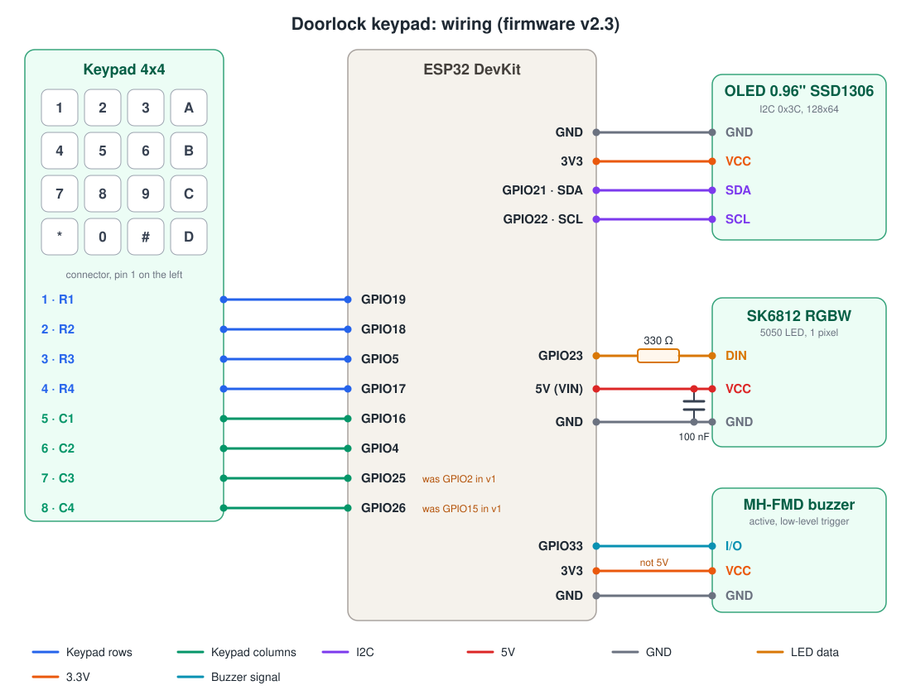
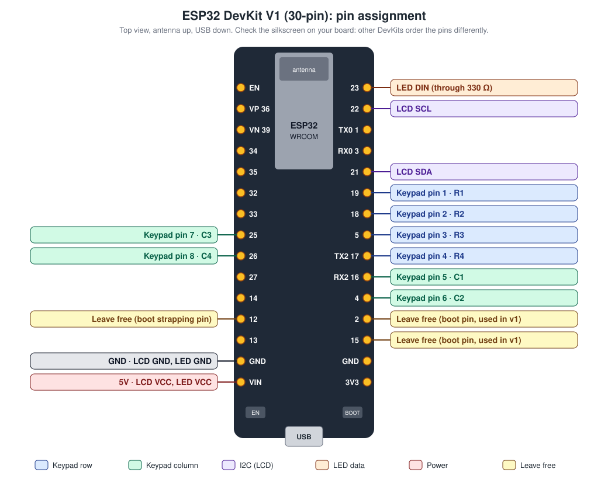

# Hardware

## Parts list

| Qty | Part | Notes |
|---|---|---|
| 1 | ESP32 DevKit (30 or 38 pins) | Build target "ESP32 Dev Module" (`esp32dev`). Prefer a WROOM module; see the GPIO 16/17 note below. |
| 1 | 4x4 membrane keypad (16 keys) | 8-pin connector: 4 rows and 4 columns. No external resistors needed. |
| 1 | 0.96" OLED, 128x64, SSD1306, I2C | 4 pins: GND, VCC, SCL, SDA (the order varies, so check the labels). Address `0x3C` (some are `0x3D`). Accepts 3.3 to 5V; power it from 3V3. No contrast potentiometer and no backlight. A 1.3" module also works but uses an SH1106 controller (see [Troubleshooting](#troubleshooting)). |
| 1 | SK6812 5050 RGBW LED | One pixel, `NEO_GRBW` color order. |
| 1 | 330 Ω resistor | In series with the LED data line (DIN). |
| 1 | 100 nF ceramic capacitor | Between LED VCC and GND, as close to the LED as possible. |
| 1 | MH-FMD active buzzer module | 3 pins: VCC, I/O, GND. Low-level trigger (a PNP transistor switches the buzzer on when I/O is LOW). The active buzzer has its own oscillator, so it beeps at one fixed pitch as long as it is switched on. |
| - | Wires, breadboard or perfboard | All parts share a common ground. |

## Wiring diagram

## Pin table

| Part | Part pin | Signal | ESP32 pin | Changed from v1 |
|---|---|---|---|---|
| Keypad | 1 | Row R1 | GPIO 19 | |
| Keypad | 2 | Row R2 | GPIO 18 | |
| Keypad | 3 | Row R3 | GPIO 5 | |
| Keypad | 4 | Row R4 | GPIO 17 | |
| Keypad | 5 | Column C1 | GPIO 16 | |
| Keypad | 6 | Column C2 | GPIO 4 | |
| Keypad | 7 | Column C3 | **GPIO 25** | was GPIO 2 |
| Keypad | 8 | Column C4 | **GPIO 26** | was GPIO 15 |
| OLED | SDA | I2C data | GPIO 21 | LCD in v2.1 |
| OLED | SCL | I2C clock | GPIO 22 | LCD in v2.1 |
| OLED | VCC | Power | **3V3** | was 5V (LCD) in v2.1 |
| OLED | GND | Ground | GND | LCD in v2.1 |
| SK6812 | DIN | LED data, through 330 Ω | GPIO 23 | |
| SK6812 | VCC | Power | 5V (VIN) | |
| SK6812 | GND | Ground | GND | |
| MH-FMD buzzer | I/O | On/off (LOW = on) | GPIO 33 | new in v2.1 |
| MH-FMD buzzer | VCC | Power | **3V3** | new in v2.1 |
| MH-FMD buzzer | GND | Ground | GND | new in v2.1 |

All pin numbers live in `src/config.h`. If you change one, update this table and both diagrams.

## Board pinout

The diagram below shows where each wire lands on the common 30-pin DevKit V1. Other DevKit boards order their pins differently, so always check the labels printed on your board.

## Electrical notes

- **OLED on 3V3.** The OLED module pulls SDA and SCL up to its own VCC. Powered from 3V3, the I2C lines stay at the ESP32 level, so no level shifter is needed. The module also accepts 5V, but then its pull-ups sit at 5V, which is outside the ESP32 specification.
- **OLED burn-in.** OLED pixels fade when they show the same image for a long time. The firmware keeps the contrast moderate (`DISPLAY_CONTRAST`) and turns the panel off at night while idle (`DISPLAY_OFF_HOUR`, `DISPLAY_ON_HOUR`).
- **LED data level.** An SK6812 powered from 5V expects a high level of about 3.5V or more, and the ESP32 outputs 3.3V. If the LED stays dark or flickers, add a 74AHCT125 buffer on DIN, or power the LED from about 4.3V by putting a diode in series with its VCC.
- **100 nF capacitor.** It decouples the LED's internal driver. One LED on short wires at low brightness often works without it, but it is recommended. Many ready-made SK6812/WS2812 boards already include one.
- **Strapping pins.** GPIO 0, 2, 12 and 15 decide how the ESP32 boots. Keep them free. v2 moved the keypad columns off GPIO 2 and 15 for this reason. GPIO 5 is also a strapping pin, but a keypad row is safe there because it is only connected to something while a key is pressed.
- **Pins to avoid.** GPIO 6 to 11 are wired to the flash chip. GPIO 34 to 39 are input-only and have no internal pull-ups, so they cannot drive a keypad.
- **GPIO 16 and 17.** On WROVER modules (the ones with PSRAM) these two pins are used by the PSRAM. On such a board, move keypad R4 and C1 to free pins (for example GPIO 27 and GPIO 32) and update `src/config.h`.
- **Buzzer at 3.3V, not 5V.** The MH-FMD switches the buzzer with a PNP transistor whose emitter sits at the module's VCC. At 5V, the ESP32's 3.3V HIGH level cannot turn the transistor off, so the buzzer would beep all the time. Powered from 3V3 it works correctly. Many active buzzers are rated 3.5 to 5V, so at 3.3V it is quieter; if it is too quiet for you, drive a 5V buzzer through an NPN transistor (HIGH = on) and set `BUZZER_ACTIVE_LOW` to `false`.
- **Buzzer idle level.** The firmware holds GPIO 33 HIGH when silent, because the module turns on with LOW. If your module or circuit switches on with HIGH, set `BUZZER_ACTIVE_LOW` to `false` in `src/config.h`.
- **Power.** Everything runs from the USB 5V through the DevKit's VIN pin. The LED uses 5V; the OLED and the buzzer use the DevKit's 3.3V regulator. At brightness 80 the single LED draws only a few milliamps, and the OLED draws about 10 to 20 mA.

## Troubleshooting

| Symptom | Likely cause and fix |
|---|---|
| OLED stays blank | Check 3V3, GND, SDA (GPIO 21) and SCL (GPIO 22); module pin order varies. If the wiring is right, try `DISPLAY_I2C_ADDRESS` `0x3D` in `src/config.h`. |
| Garbled or shifted image, with a column of noise at one edge | A 1.3" module with an SH1106 controller. Change the driver class in `src/display.h` to `U8G2_SH1106_128X64_NONAME_F_HW_I2C`. |
| Image upside down | Set `DISPLAY_ROTATE_180` to `true`. |
| Screen dark at night | Expected between 00:00 and 08:00 after 30 s without a key. Press a key. |
| Clock wrong or missing | Wrong: set `TIME_ZONE`. Missing: no WiFi or NTP yet; it appears once the time is synced. |
| Keys give the wrong digits | The keypad connector is reversed or the rows and columns are swapped. Pin 1 is usually on the left when the keys face you. |
| Some keys do nothing | A loose row or column wire. Each row and each column serves 4 keys, so the pattern of dead keys tells you which wire it is. |
| LED colors are wrong (for example red shows as green) | Your LED uses a different color order. Change `NEO_GRBW` to `NEO_RGBW` in `src/led.cpp`. |
| LED stays dark or flickers | See "LED data level" above. Also check the 330 Ω resistor and the ground connection. |
| Buzzer is silent | Check that VCC is on 3V3, I/O on GPIO 33, and GND shared with the ESP32. |
| Buzzer beeps all the time, or only when idle | VCC is on 5V instead of 3V3, or `BUZZER_ACTIVE_LOW` does not match the module. |
| Board does not boot or flash with the keypad connected | A keypad wire is on a strapping pin. Use the pins in the table above. |
