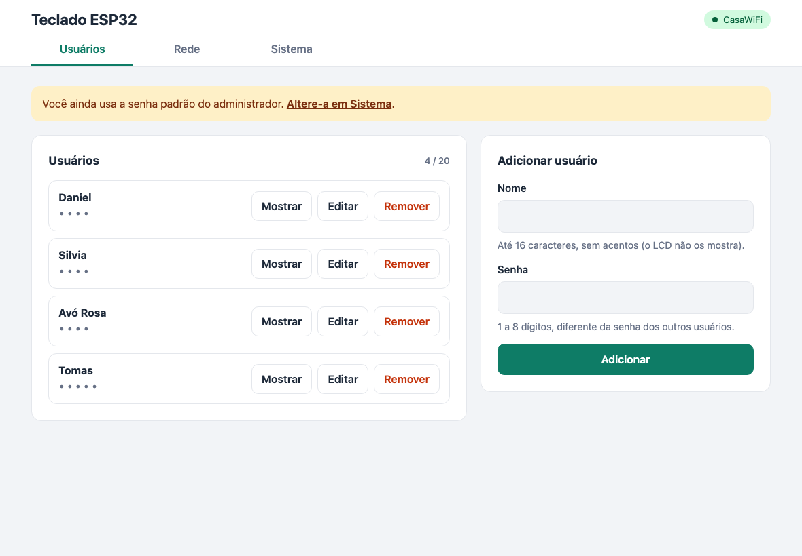

# Web admin and HTTP API

The web admin is a single page stored in the firmware. Its text is in Portuguese. It works in any modern browser and adapts to the screen:

- **Phones:** one column, full-width buttons.
- **Tablets (768 px and wider):** two columns, for example the user list next to the add/edit form.
- **Large screens (1024 px and wider):** the user list itself uses two columns.

Buttons and fields are at least 44 to 48 px tall for touch use. The page follows the system light or dark mode.



## Opening the web admin

| Situation | Address |
|---|---|
| Device connected to your network | `http://keypad.local/`, or the IP shown on the LCD (press `A` on the keypad) |
| Setup hotspot (`Teclado-XXXX`, password `teclado123`) | Opens by itself on most phones and tablets; otherwise `http://192.168.4.1/` |

The browser asks for a user name and password. The defaults are `admin` / `admin`. A yellow banner stays visible until you change the password.

> `keypad.local` relies on mDNS. It works on macOS, iOS, Linux and recent Windows versions. On Android, use the IP address.

## Tabs

### Usuários (users)

- The list shows every user with a masked PIN. **Mostrar** reveals the PIN, **Editar** loads the user into the form, and **Remover** deletes the user after a confirmation.
- The form adds a new user, or saves changes while editing. **Cancelar** leaves edit mode.
- Rules: the name has 1 to 16 characters without accents; the PIN has 1 to 8 digits and must be different from every other user's PIN. Up to 20 users.

### Rede (network)

- **Estado da conexão** shows whether the device is connected, the network name, IP, signal strength and, when it is open, the setup hotspot.
- **Configurar WiFi:** tap **Procurar redes** to scan, tap a network to fill in its name, type its password (leave it empty for an open network) and tap **Salvar e conectar**. The device saves the network and reconnects right away. If its IP changes, the page stops responding. Read the new IP on the LCD (key `A`).

### Sistema (system)

- **Dispositivo:** firmware version, network name, uptime, free memory and user count.
- **Atualizar firmware:** choose a `firmware.bin` and tap **Enviar e instalar**. A progress bar shows the upload. The device reboots into the new firmware, and the page reloads about 10 s later.
- **Acesso do administrador:** change the login user and password (4 to 64 characters, no accents). The browser then asks you to log in again.
- **Reiniciar:** reboots the device. Users and settings are kept.

## Firmware updates (OTA)

1. Build the firmware: `pio run` creates `.pio/build/esp32dev/firmware.bin`. In the Arduino IDE, use **Sketch > Export Compiled Binary**.
2. Upload it from the Sistema tab, or from a terminal:

   ```sh
   curl -u admin:yourpassword -F "firmware=@.pio/build/esp32dev/firmware.bin" http://keypad.local/api/update
   ```

The device checks the image header and writes it to the inactive app slot. It only switches to the new slot if the whole upload succeeded, so a failed or interrupted upload leaves the current firmware running. The first flash of v2 must be over USB, because it installs the partition table with larger app slots.

## HTTP API

Every route requires HTTP basic auth with the admin login. POST bodies are form-encoded (`application/x-www-form-urlencoded`), except the firmware upload, which is `multipart/form-data`.

Successful writes return `{"ok":true}`. Errors return a 4xx or 5xx status with `{"error":"<message in Portuguese>"}`.

| Method | Path | Parameters | Response |
|---|---|---|---|
| GET | `/` | | The web admin page |
| GET | `/api/status` | | Device, WiFi and user summary (see below) |
| GET | `/api/users` | | `{"max":20,"users":[{"name":"Daniel","pin":"1234"}]}` |
| POST | `/api/users` | `name`, `pin` | Adds a user |
| POST | `/api/users/update` | `index`, `name`, `pin` | Replaces the user at position `index` (0-based) |
| POST | `/api/users/delete` | `index` | Removes the user at position `index` |
| POST | `/api/wifi/scan` | | Starts a WiFi scan in the background |
| GET | `/api/wifi/scan` | | `{"scanning":true}` while scanning, then `{"scanning":false,"networks":[{"ssid":"Casa","rssi":-58,"secure":true}]}` |
| POST | `/api/wifi` | `ssid`, `pass` | Saves the network and reconnects |
| POST | `/api/admin` | `user`, `pass` | Changes the web login |
| POST | `/api/reboot` | | Reboots after about 1 s |
| POST | `/api/update` | file field (any name) | Installs the firmware and reboots after about 1.5 s |

Example `/api/status` response:

```json
{
  "version": "2.0.0",
  "uptime": 93784,
  "heap": 182340,
  "hostname": "keypad",
  "adminUser": "admin",
  "defaultPassword": true,
  "users": { "count": 2, "max": 20 },
  "wifi": {
    "configured": true,
    "connected": true,
    "ssid": "Casa",
    "ip": "192.168.1.42",
    "rssi": -58,
    "ap": false,
    "apSsid": "Teclado-1A2B",
    "apIp": ""
  }
}
```

More examples:

```sh
# List users
curl -u admin:yourpassword http://keypad.local/api/users

# Add a user
curl -u admin:yourpassword -d name=Ana -d pin=4321 http://keypad.local/api/users

# Change the PIN of the first user
curl -u admin:yourpassword -d index=0 -d name=Daniel -d pin=2580 http://keypad.local/api/users/update
```

In hotspot mode, any request for an unknown host is redirected to `http://192.168.4.1/`. This is what makes phones and tablets show the setup page automatically.
